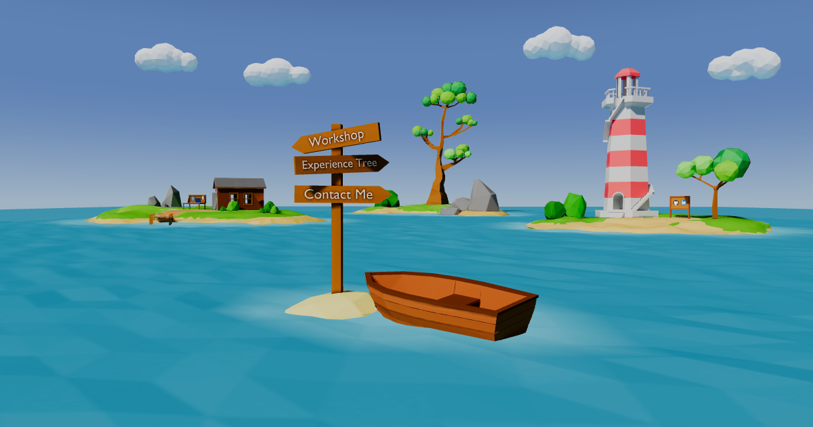

# Interactive 3D Portfolio

My personal portfolio as a set of small 3D islands you can fly between. Projects, experience and contact details sit on the islands themselves.

**Live site: [pawel-matuszak.github.io/interactive-3d-portfolio](https://pawel-matuszak.github.io/interactive-3d-portfolio/)**

[](https://pawel-matuszak.github.io/interactive-3d-portfolio/)

## Features

- Islands built in Blender and exported as Draco-compressed GLB with baked textures
- Smooth camera flights between islands, driven by the navigation bar or by clicking in the scene
- Clickable objects in the scene: project blueprints open detail cards with links to the live demo and source code
- Animated ocean, wind-blown foliage and a gradient sky
- Loading screen, intro hint, and a CV download button

## Tech stack

| Area | Tools |
| --- | --- |
| UI | React 19, TypeScript, Framer Motion |
| 3D | Three.js, React Three Fiber, Drei |
| Assets | Blender, GLB + Draco compression, baked textures |
| Tooling | Vite, ESLint, r3f-perf, lil-gui |
| Deployment | GitHub Actions → GitHub Pages |

## Running locally

Requires Node.js 22 (the version CI uses).

```bash
npm install
npm run dev       # start the dev server
npm run build     # type-check and build to dist/
npm run preview   # serve the production build
npm run lint      # run ESLint
```

## Project structure

```
src/
  components/   UI overlays: navigation bar, project cards, loading screen, CV button
  content/      Text content: projects and experience
  three/        Scene, cameras, camera flights, interactions, water and wind animation
public/static/  GLB models, baked textures and the Draco decoder
```

To change the portfolio content, edit `src/content/projects.ts` and `src/content/experience.ts`. Keys there match the mesh names in the GLB files.

## Deployment

Every push to `main` is built and deployed to GitHub Pages by `.github/workflows/deploy.yml`. Vite's `base` is set to `/interactive-3d-portfolio/` in `vite.config.ts` to match the Pages path.

## Contact

- GitHub: [Pawel-Matuszak](https://github.com/Pawel-Matuszak)
- LinkedIn: [Paweł Matuszak](https://www.linkedin.com/in/pawe%C5%82-matuszak-404a5523b/)
